# PokeTasks

<p align="center">
  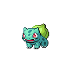
  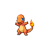
  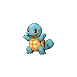
</p>

A personal to-do list with a gamified twist that lives in your Mac's menu bar. Every task you check off levels up a Pokémon, and your collection grows as you get things done.

---

> **Disclaimer:** PokeTasks is an unofficial, non-commercial fan project. It is not affiliated with, endorsed by, or connected to Nintendo, Game Freak, Creatures Inc., or The Pokémon Company. Pokémon and all related names and sprites are trademarks and property of their respective owners.

## Contents

- [How it works](#how-it-works)
  - [The basics](#the-basics)
  - [Leveling and evolution](#leveling-and-evolution)
  - [Friendship meter](#friendship-meter)
  - [Level 50: unlock a legendary](#level-50-unlock-a-legendary)
  - [Level 100: go shiny](#level-100-go-shiny)
- [Pokemon included](#pokemon-included)
- [Get it on your device](#get-it-on-your-device)
- [Future work](#future-work)

---

## How it works

### The basics

- Click the pokeball in the menu bar to open your list. Type in **Add a task…** and press Return; new tasks land at the top.
- Check a task off to level up your active Pokémon. Drag tasks to reorder them.
- Right-click (or two-finger click) a task to **Edit** it or **Add Subtask**. Checking off a subtask counts, too.
- Swipe left with two fingers to reach the **PC Box**, your whole collection. Tap any Pokémon to make it your active one.
- Completed tasks clear out together every 6 hours (or sooner with the trash button).
- Right-click the menu bar icon for **Launch at Login**, **Sound Effects**, and **Quit**.

### Leveling and evolution

Every completed task (or subtask) is **one level**, up to level 100. You start with three eggs: Bulbasaur, Charmander, and Squirtle. Your first completed task hatches the one you have active, and from there it evolves at its natural levels.

<p align="center">
  <picture>
    <source media="(prefers-color-scheme: dark)" srcset="docs/images/evolution-dark.png">
    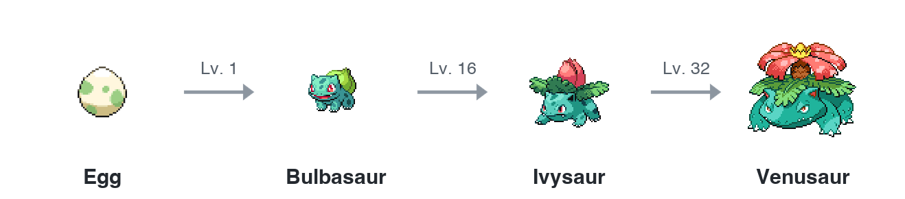
  </picture>
</p>

Charmander and Squirtle follow the same path, evolving at levels 16 and 36.

A Pokémon's name follows its evolution automatically. Give it a nickname (double-click the name) and your nickname sticks instead.

### Friendship meter

Each Pokémon has its own heart that works like a completion streak.

<p align="center">
  <picture>
    <source media="(prefers-color-scheme: dark)" srcset="docs/images/friendship-dark.png">
    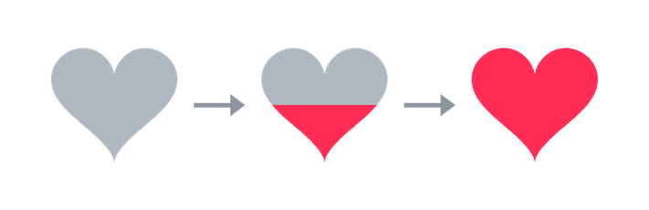
  </picture>
</p>

- **Goes up:** every task or subtask you complete while a Pokémon is active adds **1** heart level, up to **10**.
- **Decays:** if you go **12 hours** without completing anything for that Pokémon, it loses 1 level, and keeps losing 1 for every further 12 hours, down to 0. Completing a task resets the clock.
- **Only the active Pokémon decays.** Pokémon sitting in the PC Box are paused, and a Pokémon's clock starts fresh when you make it active again.
- Resetting a Pokémon, or turning it shiny, resets its friendship to 0.

### Level 50: unlock a legendary

When a starter reaches **level 50**, you can choose one of the three legendary birds to add to your collection: **Zapdos**, **Articuno**, or **Moltres**. Swipe over to the PC Box and tap a locked bird to unlock it and make it your active Pokémon. Each starter that reaches level 50 earns you one pick.

The chain keeps going:

- Get **all three birds** to level 50 and **Mewtwo** is offered to you.
- Get **Mewtwo** to level 50 and **Mew** is offered to you.

### Level 100: go shiny

When a Pokémon is at level 100, the next task you complete offers you the chance to **claim shiny**. Accept, and it goes back to **level 1 in its base form, permanently shiny**. Decline with "Not Yet" and you stay at level 100 until you're ready.

<p align="center">
  <picture>
    <source media="(prefers-color-scheme: dark)" srcset="docs/images/shiny-reset-dark.png">
    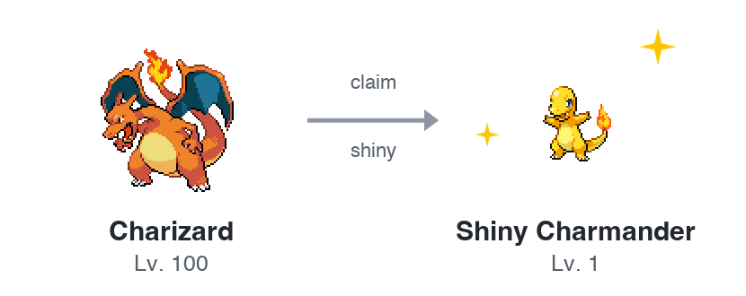
  </picture>
</p>

This is a one-time reset for each Pokémon. You can also reset a Pokémon manually with the ↺ button in the header, or the whole collection from the PC Box (after confirming); a full reset adds a free **Choose your Starter!** task so you can hatch a new egg right away.

## Pokemon included

Every Pokémon in the current version (Generation 1), each with a normal and a shiny form:

| Sprite | Name | How you get it |
| :---: | --- | --- |
|  | Bulbasaur | Starter egg |
| 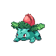 | Ivysaur | Bulbasaur at Lv. 16 |
| 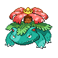 | Venusaur | Ivysaur at Lv. 32 |
|  | Charmander | Starter egg |
| 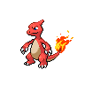 | Charmeleon | Charmander at Lv. 16 |
| 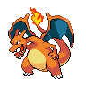 | Charizard | Charmeleon at Lv. 36 |
|  | Squirtle | Starter egg |
| 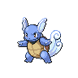 | Wartortle | Squirtle at Lv. 16 |
| 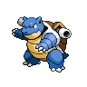 | Blastoise | Wartortle at Lv. 36 |
| 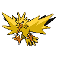 | Zapdos | Pick one when a starter hits Lv. 50 |
| 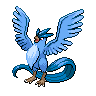 | Articuno | Pick one when a starter hits Lv. 50 |
| 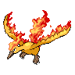 | Moltres | Pick one when a starter hits Lv. 50 |
| 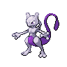 | Mewtwo | All three birds at Lv. 50 |
| 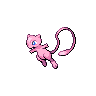 | Mew | Mewtwo at Lv. 50 |

## Get it on your device

**You'll need:** a Mac running **macOS 14 (Sonoma) or later** and **Xcode** (free from the Mac App Store) with its command line tools. No Apple Developer account is required; the app builds with a local ad-hoc signature.

1. **Clone the repo.**

   ```bash
   git clone https://github.com/tuhinc5203/PokeTasks.git
   cd PokeTasks
   ```

2. **Build it.** The first time you use Xcode on a Mac you may need to accept its license: `sudo xcodebuild -license`.

   ```bash
   xcodebuild -project PokeTasks.xcodeproj -scheme PokeTasks -configuration Release -derivedDataPath build build
   ```

3. **Install and open it.**

   ```bash
   cp -R build/Build/Products/Release/PokeTasks.app /Applications/
   open /Applications/PokeTasks.app
   ```

A pokeball appears in your menu bar. Click it to get started.

Prefer Xcode? Open `PokeTasks.xcodeproj` and press **Run** (⌘R) instead.

A few notes:

- Your tasks and Pokémon are stored locally in the app's preferences, so nothing leaves your Mac.
- The app also keeps a running log of every task you add in `TodoArchive.md`, inside the folder you built from. It's git-ignored, so it stays on your machine.
- **Launch at Login** works best when the app lives in `/Applications`.

## Future work

- **More generations.** Gen 1 is the starting point. Later generations (new starters, evolution lines, and legendaries) can be added as their own roster files without changing how leveling works.
